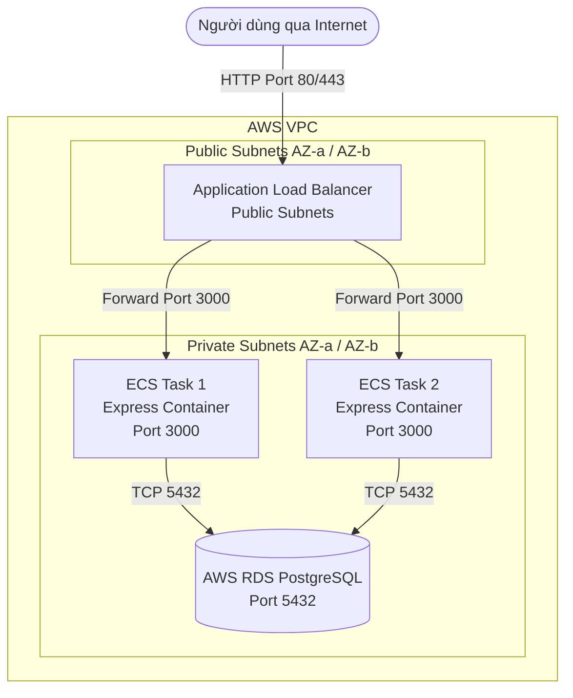

# ExpressJS API kết nối RDS & Triển khai lên AWS ECS (Fargate)

Dự án mẫu ExpressJS chuẩn DevOps: kết nối đến cơ sở dữ liệu AWS RDS (PostgreSQL), container hóa với Docker, và hướng dẫn triển khai lên **AWS ECS (Fargate)** kết hợp **Application Load Balancer (ALB)** để có thể truy cập công khai qua Internet.

---

## 1. Kiến trúc hệ thống (System Architecture)



### Nguyên lý bảo mật:
1. **ALB (Public Subnet)**: Nhận traffic từ Internet (Security Group: Allow 0.0.0.0/0 port 80/443).
2. **ECS Tasks (Private hoặc Public Subnet)**: Chỉ cho phép kết nối inbound ở port 3000 từ chính Security Group của ALB.
3. **RDS Database (Private Subnet)**: Chỉ cho phép kết nối inbound ở port 5432 từ Security Group của ECS Tasks. Tuyệt đối không mở ra Internet.

---

## 2. Danh sách các API GET

| Method | Endpoint | Mô tả |
| :--- | :--- | :--- |
| **GET** | `/` | Thông tin chào mừng và danh sách các endpoint khả dụng. |
| **GET** | `/health` | **Health check endpoint** cho ALB Target Group. Trả về trạng thái server và tình trạng kết nối DB. |
| **GET** | `/api/info` | Trả về thông tin runtime: Hostname (Container ID), Uptime, Memory, Client IP (rất hữu ích để kiểm tra Load Balancing giữa các tasks). |
| **GET** | `/api/users` | Lấy toàn bộ danh sách users từ bảng `users` trong RDS. Tự động seed dữ liệu mẫu khi khởi động. |
| **GET** | `/api/users/:id` | Lấy thông tin chi tiết một user theo ID từ RDS. |

---

## 3. Cấu trúc thư mục

```text
lession10-11/
├── src/
│   ├── db.js                   # Kết nối Connection Pool tới RDS PostgreSQL & auto migration
│   ├── routes.js               # Định nghĩa các API GET và health check
│   └── server.js               # Khởi tạo Express server, graceful shutdown
├── .dockerignore
├── .env.example                # File mẫu các biến môi trường
├── .gitignore
├── Dockerfile                  # Multi-layer Docker image tối ưu (Node 20 Alpine, non-root)
├── ecs-task-definition.json    # JSON template cấu hình ECS Task Definition
├── package.json
└── README.md
```

---

## 4. Kiểm tra Docker Image tại Local (Tùy chọn)

Trước khi đẩy lên ECR, bạn có thể build thử Docker image ngay tại local:

```bash
# Build image
docker build -t express-rds-demo .

# Kiểm tra image vừa build
docker images | grep express-rds-demo
```

---

## 5. Hướng dẫn chi tiết triển khai lên AWS ECS & RDS

### Bước 1: Chuẩn bị Cơ sở dữ liệu AWS RDS (PostgreSQL)
1. Vào AWS Console > **RDS** > **Create database**.
2. Chọn **PostgreSQL** (hoặc Free tier / Dev/Test).
3. Cấu hình:
   - **DB instance identifier**: `express-db`
   - **Master username**: `postgres`
   - **Master password**: Nhập mật khẩu an toàn (ví dụ: `YourSecurePassword123`).
   - **Initial database name**: `mydb` (trong mục *Additional configuration*).
4. **VPC & Connectivity**:
   - Chọn VPC mong muốn (mặc định hoặc custom VPC).
   - **Public access**: **No** (Khuyến nghị bảo mật).
   - **VPC security group**: Tạo mới `rds-sg`.
5. Sau khi tạo xong, copy **Endpoint** (ví dụ: `express-db.cxxxxxxx.us-east-1.rds.amazonaws.com`).

---

### Bước 2: Tạo AWS ECR & Đẩy Docker Image lên

1. Vào AWS Console > **ECR (Elastic Container Registry)** > **Create repository**.
   - Tên repo: `express-rds-demo` (Visibility: *Private*).
2. Mở terminal tại thư mục dự án và chạy các lệnh (thay thế `<AWS_ACCOUNT_ID>` và `<REGION>`):

```bash
# Đăng nhập AWS ECR
aws ecr get-login-password --region <REGION> | docker login --username AWS --password-stdin <AWS_ACCOUNT_ID>.dkr.ecr.<REGION>.amazonaws.com

# Build image
docker build -t express-rds-demo .

# Tag image
docker tag express-rds-demo:latest <AWS_ACCOUNT_ID>.dkr.ecr.<REGION>.amazonaws.com/express-rds-demo:latest

# Push image lên ECR
docker push <AWS_ACCOUNT_ID>.dkr.ecr.<REGION>.amazonaws.com/express-rds-demo:latest
```

---

### Bước 3: Cấu hình Security Groups trên AWS VPC

Tạo 3 Security Groups để liên kết bảo mật chặt chẽ:
1. **`alb-sg`** (Security Group cho Load Balancer):
   - Inbound: HTTP (port 80) từ `0.0.0.0/0`.
   - Inbound: HTTPS (port 443) từ `0.0.0.0/0` (nếu có SSL Certificate).
2. **`ecs-tasks-sg`** (Security Group cho ECS Task):
   - Inbound: Custom TCP (port 3000), Source chọn **`alb-sg`**.
   - Outbound: All traffic (`0.0.0.0/0`) để tải image và kết nối RDS.
3. **`rds-sg`** (Security Group cho RDS):
   - Inbound: PostgreSQL (port 5432), Source chọn **`ecs-tasks-sg`**.

---

### Bước 4: Tạo Target Group & Application Load Balancer (ALB)

1. Vào **EC2** > **Target Groups** > **Create target group**:
   - **Target type**: `IP addresses` (bắt buộc đối với ECS Fargate chạy network mode `awsvpc`).
   - **Target group name**: `express-tg`
   - **Protocol:Port**: `HTTP : 3000`
   - **Health check path**: `/health`
   - Lưu target group (chưa cần đăng ký IP nào, ECS Service sẽ tự đăng ký).
2. Vào **EC2** > **Load Balancers** > **Create load balancer** > **Application Load Balancer**:
   - **Name**: `express-alb`
   - **Scheme**: `Internet-facing`
   - **IP address type**: `IPv4`
   - **VPC & Subnets**: Chọn VPC và **tối thiểu 2 Public Subnets** ở 2 Availability Zones khác nhau.
   - **Security groups**: Chọn `alb-sg`.
   - **Listeners and routing**: HTTP port 80 -> Forward to Target Group `express-tg`.
   - Nhấn **Create load balancer**. Lưu lại **DNS Name** của ALB (ví dụ: `express-alb-123456789.us-east-1.elb.amazonaws.com`).

---

### Bước 5: Tạo ECS Cluster & Task Definition

1. Vào **ECS** > **Clusters** > **Create cluster**:
   - Cluster name: `production-cluster`
   - Infrastructure: **AWS Fargate (serverless)**.
2. Vào **Task Definitions** > **Create new task definition** > Tạo bằng giao diện hoặc dùng file [ecs-task-definition.json](ecs-task-definition.json):
   - **Task definition family**: `express-rds-task`
   - **Launch type**: `AWS Fargate`
   - **OS/Architecture**: `Linux/X86_64`
   - **Task size**: CPU `0.25 vCPU` (256), Memory `0.5 GB` (512).
   - **Task execution role**: Chọn `ecsTaskExecutionRole` (để ECS có quyền pull image từ ECR và ghi log vào CloudWatch).
   - **Container details**:
     - Name: `express-container`
     - Image URI: `<AWS_ACCOUNT_ID>.dkr.ecr.<REGION>.amazonaws.com/express-rds-demo:latest`
     - Port mappings: Container port `3000` (TCP, HTTP).
     - **Environment variables**:
       - `PORT` = `3000`
       - `NODE_ENV` = `production`
       - `DB_HOST` = `<RDS_ENDPOINT>` (ví dụ: `express-db.xxxx.us-east-1.rds.amazonaws.com`)
       - `DB_PORT` = `5432`
       - `DB_NAME` = `mydb`
       - `DB_USER` = `postgres`
       - `DB_PASSWORD` = `<MẬT_KHẨU_RDS>` (Hoặc dùng AWS Secrets Manager/SSM Parameter Store)
       - `DB_SSL` = `true`

---

### Bước 6: Tạo ECS Service và kết nối với ALB

1. Vào Cluster `production-cluster` > Tab **Services** > **Create**:
   - **Compute configuration**: Launch type `FARGATE`.
   - **Deployment configuration**:
     - Application type: `Service`
     - Family: `express-rds-task`
     - Service name: `express-service`
     - Desired tasks: `2` (chạy 2 task để dự phòng high availability).
   - **Networking**:
     - Chọn VPC.
     - Subnets: Chọn các Subnets (có thể là Private Subnet nếu có NAT Gateway, hoặc Public Subnet có bật *Auto-assign public IP* để Fargate kéo image từ ECR).
     - Security Group: Chọn `ecs-tasks-sg`.
   - **Load balancing**:
     - Load balancer type: **Application Load Balancer**.
     - Chọn existing ALB: `express-alb`.
     - Container to load balance: `express-container 3000:3000`.
     - Target group: Chọn `express-tg` đã tạo ở Bước 4.
2. Nhấn **Create**.
3. ECS sẽ tự động khởi chạy 2 container tasks, đăng ký IP của 2 task vào Target Group, và thực hiện Health Check qua `/health`. Khi status chuyển sang `Healthy`, hệ thống đã sẵn sàng phục vụ.

---

## 6. Kiểm tra gọi API qua Internet

Sử dụng DNS Name của Application Load Balancer để gọi thử từ máy tính của bạn:

```bash
export ALB_URL="http://express-alb-123456789.us-east-1.elb.amazonaws.com"

# 1. Gọi Health check
curl $ALB_URL/health

# 2. Gọi API danh sách Users từ RDS
curl $ALB_URL/api/users

# 3. Lấy chi tiết 1 User
curl $ALB_URL/api/users/1

# 4. Kiểm tra Load Balancing giữa các Task ECS
curl $ALB_URL/api/info
# Gọi lại nhiều lần, bạn sẽ thấy trường "hostname" thay đổi giữa các Container ID của 2 Task!
```
